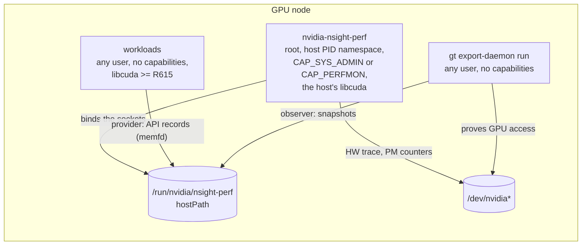

# Deployment

How to run gt with the NVIDIA Nsight Perf service on GPU nodes, in Docker and in Kubernetes, and which permissions
each part needs. Three parts run on every node:

- **`nvidia-nsight-perf`**, the Nsight Perf service (an NVIDIA binary). It collects libcuda's API records, the GPU
  hardware trace, GR-context switches and PM counters, and keeps a rolling history. One per node. It is the only part
  that needs privileges.
- **gt** (`gt export-daemon run`) reads the service's snapshots, serves `/metrics`, and persists or streams every
  activity. It needs no privileges.
- **The workloads** are unchanged CUDA processes. Their libcuda (≥ R615) finds the service through its socket directory
  and hands it their API records.



Statements marked **verified** were measured with [`bench/deploy_check.sh`](#verified-with-benchdeploy_checksh) on
a Kubernetes GPU cluster:
- Kernel driver 580.173.02 with `RmProfilingAdminOnly: 1`.
- The workloads ran on the CUDA 13.5 forward-compat libcuda (620.70.06).
- SDK beta-preview `bd5d590`, 2026-11-17.

The rest comes from NVIDIA's documentation: the daemon
[README](https://github.com/NVIDIA/nsight-perf-daemon/blob/main/README.md) and
[Linux installation guide](https://github.com/NVIDIA/nsight-perf-daemon/blob/main/docs/LinuxInstallationGuide.md),
and the SDK [README](https://github.com/NVIDIA/nsight-perf-sdk-for-ai/blob/main/README.md).

## What each part needs

| | Nsight Perf service | gt | workloads |
|---|---|---|---|
| per node | exactly one (each GPU can belong to one service) | one | any number |
| user | root | any (verified: 65534) | any (verified: 1000) |
| capabilities | `CAP_SYS_ADMIN` (verified) or `CAP_PERFMON`, when the driver restricts GPU profiling | none (verified) | none (verified) |
| PID namespace | the host's (`hostPID` / `--pid=host`) | its own (verified); process titles need the host's `/proc`, mounted read-only (verified with hostPID) | its own (verified) |
| `/run/nvidia/nsight-perf` | hostPath, read-write: it binds the sockets | hostPath, read-only (verified) | hostPath, read-only (verified); without it the process is not traced (verified) |
| `/run/nvidia/nvtx` | hostPath, read-write | – | hostPath, read-only, for NVTX ranges |
| GPUs | all: `NVIDIA_VISIBLE_DEVICES=all`, no `nvidia.com/gpu` request | all, the same way; without them gt sees no GPU data (verified) | their own |
| libcuda | the host driver's own; not a forward-compat libcuda | none: gt does not load CUDA | ≥ R615: a host driver ≥ 620 with any image, or the CUDA 13.5 compat package in the image on a kernel driver ≥ 580.95.05 (verified; [details](#the-workloads-libcuda-and-images)) |
| not needed | privileged, `SYS_PTRACE` (verified), hostIPC, hostNetwork | root, hostPID, any capability, hostIPC | hostPID, hostIPC, a shared `/dev/shm` (verified) |
| start | first, when the node boots | any time after the service | after the service |

### GPU profiling permission (the service only)

The NVIDIA kernel module restricts GPU performance counters to administrators unless told otherwise. Check it with
`grep RmProfilingAdminOnly /proc/driver/nvidia/params`. With `1` (the default), the service needs one of these:

- **`CAP_SYS_ADMIN`**: verified.
- **`CAP_PERFMON`**: NVIDIA's documented choice for R580+, and narrower. It is not verified here: the test
  environment's capability bounding set did not include it.
- **R610+ group permission** on the `profiler-device` and `trace-device` nodes in `/dev/nvidia-caps`.
- **The module parameter `NVreg_RestrictProfilingToAdminUsers=0`**: profiling for every user. It is deprecated.

gt and the workloads never need this permission.

**Without the permission, nothing reports a failure** (verified):
- The service starts, and its log shows no error.
- `nvtrace_poll_until_service_ready` prints "All required GPU providers are measuring".
- `gt export` prints `successful`.
- The trace holds only the CUDA API calls: no kernel, no GPU time, no PM sample.

So check the data ([Checks after deployment](#checks-after-deployment)), not the readiness tool.

### The service's PID namespace and libcuda

- **PID namespace.** The service learns each traced process's host PID from the socket's peer credentials and
  correlates it with the driver's records. NVIDIA therefore requires the service in the host PID namespace. The
  traced process's PID namespace must be the service's or a descendant of it, which every container's is. gt and the
  workloads keep their own PID namespaces (verified).
- **libcuda.** GR-context tracing requires the user-mode driver the service loads to match the host's kernel-mode
  driver. GR-context tracing records which context runs on a GPU when, and it is what attributes GPU work to processes
  that share a GPU. A forward-compat libcuda does not qualify.
  - Build the service image without the CUDA toolkit and without `cuda-compat`, so the only libcuda is the host's,
    which the NVIDIA container runtime mounts. NVIDIA_VISIBLE_DEVICES and the runtime do the rest.
  - In a `nvidia/cuda:13.x` image, the runtime enables forward compat, and the service would load the compat libcuda.
    The bench scripts avoid that with `LD_LIBRARY_PATH` pointing at symlinks to the host's libraries.
  - Our test of a compat libcuda in the service only partly covers this. With the compat libcuda 620 on the 580
    kernel driver, one process per GPU was still traced completely. That says nothing about GPUs shared by several
    processes.

### The workloads' libcuda and images

The CUDA API tracing is built into libcuda, the user-mode driver. What a workload needs is a new enough libcuda in its
process, not a CUDA 13.5 image: the CUDA toolkit and runtime the application was built with do not matter.

- **Host driver 620 or newer** (the SDK's baseline): any image. The NVIDIA runtime mounts the host's libcuda into the
  container. Applications built with CUDA 12 should work as well (a driver runs older runtimes), but none was tested.
- **Kernel driver 580.95.05 up to 620**: the image carries the CUDA 13.5 forward-compatibility package,
  `cuda-compat-13-5`: `libcuda.so.620.*` and the JIT / compiler libraries of the same driver, about 450 MB in
  `/usr/local/cuda-13.5/compat`. That is not the CUDA 13.5 toolkit, and the base image need not be `nvidia/cuda:13.5`. The application's own CUDA runtime may be older: torch
  `2.14.0+cu132` (the CUDA 13.2 runtime) with the compat libcuda 620.70.06 on kernel driver 580.173.02 was traced
  completely (verified).
  - **Getting it.** It is an apt package, installed when the image is built: nothing is downloaded on the nodes or at
    run time. `nvidia/cuda:13.5.*` images have it (the tests used `nvidia/cuda:13.5.0-devel-ubuntu24.04`). Another
    Ubuntu image installs it from NVIDIA's CUDA repository (this Dockerfile was not built here):

    ```dockerfile
    # The repository of the image's Ubuntu release (ubuntu2204, ubuntu2404); x86_64 on amd64, sbsa on arm64 servers.
    RUN apt-get update && apt-get install -y --no-install-recommends ca-certificates curl \
     && curl -fsSLo /tmp/cuda-keyring.deb "https://developer.download.nvidia.com/compute/cuda/repos/ubuntu2404/$(uname -m | sed s/aarch64/sbsa/)/cuda-keyring_1.1-1_all.deb" \
     && dpkg -i /tmp/cuda-keyring.deb && rm /tmp/cuda-keyring.deb \
     && apt-get update && apt-get install -y --no-install-recommends cuda-compat-13-5 \
     && rm -rf /var/lib/apt/lists/*
    ```

    An image that already has NVIDIA's repository (every `nvidia/cuda` image does) needs only the last
    `apt-get install`.
  - **Enabling it.** The NVIDIA Container Toolkit puts the compat directory in front of the host's libcuda in the
    container's linker cache by itself when the compat libcuda is the newer one; in the tests it wrote
    `/etc/ld.so.conf.d/00-compat-*.conf`. If the check below still shows the host's libcuda (for example in an image
    built on an older `nvidia/cuda`, whose `/usr/local/cuda` points at that version), put
    `/usr/local/cuda-13.5/compat` first on `LD_LIBRARY_PATH`.
  - Which libcuda a workload loaded: `grep -m1 -o 'libcuda\.so[.0-9]*' /proc/<pid>/maps` prints `libcuda.so.620.*`,
    not the host driver's version.
- **Limits.**
  - Forward compatibility works on data-center GPUs only (NVIDIA).
  - GPU power metrics need a kernel driver ≥ R615 whatever the libcuda.
  - The SDK names driver 620, or the CUDA 13.5 compat package, as its minimum. libcuda has the API tracing from R615
    on, but older compat packages were not tested.
- **Never in the service's image.** The service loads the host's libcuda
  ([above](#the-services-pid-namespace-and-libcuda)).

### The socket directory and the GPUs

- **The socket directory.** The service creates `router.provider/.sock`, `router.observer/.sock` and
  `router.controller/.sock` under `/run/nvidia/nsight-perf`. As root it always runs in this global scope.
  - Everything that talks to the service must see that directory at that same path, so mount it as a hostPath.
  - Read-only is enough for gt and the workloads (verified): connecting to a socket needs no write access to the
    mount.
  - The service's default `securityPolicy` admits every user (`/everyone`). To restrict it, configure the policy in
    the service's YAML (`NVIDIA_NSIGHT_PERF_CONFIG_PATH`).
- **No shared memory setup.** Workloads hand their trace buffers to the service as memfds over the socket. The
  traced load mapped 3 `memfd:` regions, the untraced one none (verified). So no hostIPC and no shared `/dev/shm` are
  needed.
- **GPUs for the service and for gt.** The service samples the GPUs. gt must be able to open them too: the service
  shows a client only the GPUs the client can open read-write itself.
  - A gt without `/dev/nvidia*` recorded only the API calls, and still printed `successful` (verified).
  - Give both every GPU without taking any from the scheduler: `NVIDIA_VISIBLE_DEVICES=all` and no `nvidia.com/gpu`
    request.
  - This needs the NVIDIA runtime as the node's default runtime, with device selection by environment allowed for
    unprivileged containers (`accept-nvidia-visible-devices-envvar-when-unprivileged`, true by default). Where it is
    not, both containers need `privileged: true`.

### Order and opting out

- **Start the service first.** A process that started before the service is never traced (`bench/order.sh`).
- **A restarted service loses the processes attached to the previous one** (NVIDIA). Restart those workloads, and gt
  as well.
- **Opting out.** A workload sets `CUDA_NSIGHT_PERF_FORCE_DISABLE_CUDA_TRACING=1` (and
  `CUDA_NSIGHT_PERF_FORCE_DISABLE_NVTX_TRACING=1`) to stay out of the trace. Without the socket directory mounted, it
  is not traced either (verified).

## Verified with `bench/deploy_check.sh`

The script runs each part as it would run in a container of its own, inside one pod with hostPID and `CAP_SYS_ADMIN`.
Each part gets its own PID, IPC and mount namespaces, its own `/dev/shm` and `/tmp`, and its own user and capabilities
(`unshare`, `setpriv`). Only `/run/nvidia/nsight-perf`, `/run/nvidia/nvtx` and `/dev/nvidia*` are shared.

The parts:
- **The service**: root in the host PID namespace, on GPUs 0 and 1.
- **gt-a**: `gt export` as uid 65534 with no capabilities, the socket directories mounted read-only.
- **gt-nodev**: the same without `/dev/nvidia*`.
- **load-a**: a CUDA-graph load with known kernel counts (`bench/graphload.py`, 300 graph-node kernels and 20 eager
  kernels per replay) on GPU 0. It runs as uid 1000 with no capabilities, the socket directories mounted read-only.
- **load-b**: the same load on GPU 1 with `/run/nvidia` hidden.

| run | the service | load-a: graph-node kernels in gt's trace | PM samples | load-b: kernels | gt-nodev |
|---|---|---|---|---|---|
| default | Docker's default capabilities + `SYS_ADMIN`, the host's libcuda | 12,986,700 of 12,986,700 | 1,291,235 | 0 | API calls only (0 kernels, 0 PM) |
| `SVC_DROP=-sys_admin,-sys_ptrace` | Docker's default capabilities | **0** (930,991 API calls only); readiness check passed, `gt export` printed `successful` | **0** | 0 | API calls only |
| `HOSTDRV=` | + `SYS_ADMIN`, the compat libcuda 620 | 13,393,200 of 13,393,200 | 1,296,702 | 0 | API calls only |

- The eager kernels in the trace are 302 more than the load counts in its timed loop: its warm-up.
- `SYS_PTRACE` was dropped in every run. The service still traced a uid-1000 process in another PID namespace.
- All runs had seccomp off (Kubernetes' default, `Unconfined`). Docker's default seccomp profile and Kubernetes'
  `RuntimeDefault` were not tested.

```sh
bash bench/deploy_check.sh                                    # hostPID + CAP_SYS_ADMIN; GPUs 0 and 1 idle
SVC_DROP=-sys_admin,-sys_ptrace bash bench/deploy_check.sh    # the service without SYS_ADMIN
HOSTDRV= bash bench/deploy_check.sh                           # the service on the image's (compat) libcuda
```

## Node prerequisites

- **GPUs and OS**: GPUs the Nsight Perf SDK supports (see its README); amd64 or aarch64. The SDK targets an Ubuntu 24.04 userland, which
  the images below use.
- **Driver**: as in the table. Check `cat /proc/driver/nvidia/version` and
  `grep RmProfilingAdminOnly /proc/driver/nvidia/params`.
- **Container runtime**: the NVIDIA Container Toolkit. In Docker that is `--gpus`; in Kubernetes, the nvidia runtime
  as containerd's default.
- **No other Nsight Perf service on the node.** That includes the systemd unit from NVIDIA's installer, which shares
  the `router.lock` single-instance lock and the GPUs' PM counters, and a user-local `nvidia-nsight-perf` someone
  started by hand.

## Images

Build on a machine of the nodes' architecture (amd64 or aarch64), as in the README's
[Build](../README.md#build) section, with `--features monitor` (the default build is `gt dump` only). Then stage the
files:

```sh
mkdir -p image/service image/gt
cp $NVTRACE_SDK_DIR/build/bin/{nvidia-nsight-perf,nvtrace_poll_until_service_ready,*.config} image/service/
cp $CARGO_TARGET_DIR/release/gt $NVTRACE_SDK_DIR/build/bin/libnvperf_grfx_host.so image/gt/
```

`image/service/Dockerfile`:

```dockerfile
# No CUDA toolkit and no cuda-compat: the only libcuda is the host driver's, which the NVIDIA runtime mounts.
FROM ubuntu:24.04
RUN apt-get update && apt-get install -y --no-install-recommends procps && rm -rf /var/lib/apt/lists/*
# *.config: the metric configurations the default YAML loads from {ServiceBinaryDirectory}.
COPY nvidia-nsight-perf nvtrace_poll_until_service_ready *.config /opt/nsight-perf/
ENTRYPOINT ["/opt/nsight-perf/nvidia-nsight-perf", "--global"]
```

`image/gt/Dockerfile`:

```dockerfile
FROM ubuntu:24.04
COPY gt /usr/local/bin/gt
# Loaded for PM metric evaluation.
COPY libnvperf_grfx_host.so /opt/gravity-trace/lib/
ENV LD_LIBRARY_PATH=/opt/gravity-trace/lib
# Writable for the unprivileged user: the pid file, and the persisted trace / captures (named volumes start as this).
RUN mkdir -p /run/gravity-trace /var/lib/gravity-trace && chown 65534:65534 /run/gravity-trace /var/lib/gravity-trace
USER 65534:65534
ENTRYPOINT ["/usr/local/bin/gt"]
CMD ["export-daemon", "run"]
```

- **What the binaries need.** The service links only glibc, libgcc and libcuda. gt links glibc, libstdc++ and
  libgcc_s, and loads `libnvperf_grfx_host.so` with `dlopen`, so `ldd` does not list it. Without that library gt
  still runs, prints `NVPW_InitializeHost failed ...`, and its trace has no PM metrics: the service's default YAML
  (`metricsToEvaluateOnline: []`) leaves all of them to the consumer.
- **The base image.** A gt built on Ubuntu 24.04 needs glibc 2.39 or newer and the libstdc++ of GCC 12 or newer
  (`GLIBCXX_3.4.30`); `libnvperf_grfx_host.so` needs glibc 2.25. `ubuntu:24.04` and `debian:13` have them.
  `debian:12` and the images built on it (distroless `*-debian12` included), `ubuntu:22.04` and UBI 9 have an older
  glibc, and gt fails to start there with ``version `GLIBC_2.39' not found``. Alpine and `scratch` have no glibc.
  `objdump -T gt | grep -o 'GLIBC_[0-9.]*' | sort -uV | tail -1` prints what a binary needs.
- **No static gt.** `libnvperf_grfx_host.so` is a glibc shared library, and a statically linked gt (glibc or musl)
  cannot `dlopen` it: the PM metrics would be missing. The `gt dump`-only build has no such dependency (see
  [Reading the persisted trace](#reading-the-persisted-trace)).
- **Licensing.** `nvidia-nsight-perf` and `libnvperf_grfx_host.so` are proprietary (the Nsight Perf SDK license).
  Check it before pushing the images outside your organization.
- **Not built yet.** These two Dockerfiles have not been built (no container builder was at hand). Their files,
  paths and libraries are the ones the tests used.

## Kubernetes

### Namespace

The service needs hostPID, a capability and hostPath volumes, which only the `privileged` Pod Security level allows:

```yaml
apiVersion: v1
kind: Namespace
metadata:
  name: gravity-trace
  labels:
    pod-security.kubernetes.io/enforce: privileged
```

### The service

```yaml
apiVersion: apps/v1
kind: DaemonSet
metadata:
  name: nvidia-nsight-perf
  namespace: gravity-trace
spec:
  selector:
    matchLabels: {app: nvidia-nsight-perf}
  template:
    metadata:
      labels: {app: nvidia-nsight-perf}
    spec:
      hostPID: true                                   # correlates the driver's host PIDs with the traced processes
      nodeSelector: {nvidia.com/gpu.present: "true"}
      tolerations: [{operator: Exists}]
      priorityClassName: system-node-critical         # scheduled first, evicted last
      containers:
        - name: service
          image: registry.example.com/nvidia-nsight-perf:beta-preview
          env:
            - {name: NVIDIA_VISIBLE_DEVICES, value: all}   # every GPU, none taken from the scheduler
            - {name: NVIDIA_DRIVER_CAPABILITIES, value: "compute,utility"}
          securityContext:
            runAsUser: 0
            capabilities:
              # GPU counters with RmProfilingAdminOnly: 1. PERFMON is narrower (NVIDIA's choice, R580+) but not
              # verified here: after switching, run the checks below.
              add: ["SYS_ADMIN"]
          readinessProbe:                             # passes without the GPU counter permission too
            exec:
              command: ["/opt/nsight-perf/nvtrace_poll_until_service_ready", "--timeout-sec", "5"]
            periodSeconds: 30
            timeoutSeconds: 10
          resources:                                  # measured: 0.02 cores, 181 MiB RSS (vLLM on one GPU)
            requests: {cpu: 100m, memory: 256Mi}
            limits: {memory: 2Gi}
          volumeMounts:
            - {name: sockets, mountPath: /run/nvidia/nsight-perf}
            - {name: nvtx, mountPath: /run/nvidia/nvtx}
      volumes:
        - name: sockets
          hostPath: {path: /run/nvidia/nsight-perf, type: DirectoryOrCreate}
        - name: nvtx
          hostPath: {path: /run/nvidia/nvtx, type: DirectoryOrCreate}
```

### gt

```yaml
apiVersion: apps/v1
kind: DaemonSet
metadata:
  name: gravity-trace
  namespace: gravity-trace
spec:
  selector:
    matchLabels: {app: gravity-trace}
  template:
    metadata:
      labels: {app: gravity-trace}
    spec:
      nodeSelector: {nvidia.com/gpu.present: "true"}
      tolerations: [{operator: Exists}]
      terminationGracePeriodSeconds: 90               # > daemon.stop_timeout_s (60): SIGTERM finishes the open files
      initContainers:
        - name: chown                                 # the hostPath below is created root-owned
          image: registry.example.com/gravity-trace:0.1.0
          command: ["chown", "65534:65534", "/var/lib/gravity-trace"]
          securityContext: {runAsUser: 0}
          volumeMounts: [{name: data, mountPath: /var/lib/gravity-trace}]
      containers:
        - name: gt
          image: registry.example.com/gravity-trace:0.1.0
          args: ["export-daemon", "run"]
          env:
            - {name: NVIDIA_VISIBLE_DEVICES, value: all}   # without the GPUs gt gets the API calls only
            - {name: NVIDIA_DRIVER_CAPABILITIES, value: "compute,utility"}
            - {name: GT_LIMITS_MAX_CPUS, value: "4"}
            - {name: GT_PERSIST_MAX_DISK_GIB, value: "64"}
            - {name: GT_COLLECT_HOST_PROC, value: /host/proc}   # the host's /proc, mounted below
            # Streaming instead of persisting:
            # - {name: GT_FLIGHTSQL_ENABLED, value: "true"}
            # - {name: GT_FLIGHTSQL_ENDPOINT, value: "grpc://flightsql.example:50051"}
            # - name: GT_FLIGHTSQL_PASSWORD
            #   valueFrom: {secretKeyRef: {name: gt-flightsql, key: password}}
          ports: [{name: metrics, containerPort: 9465}]
          securityContext:
            runAsUser: 65534
            runAsGroup: 65534
            runAsNonRoot: true
            allowPrivilegeEscalation: false
            capabilities: {drop: ["ALL"]}
          readinessProbe:
            tcpSocket: {port: metrics}
          resources:                                  # measured: 0.75 cores, 2.5 GB RSS at 770 K activities/s
            requests: {cpu: "1", memory: 4Gi}
            limits: {cpu: "4", memory: 8Gi}
          volumeMounts:
            - {name: sockets, mountPath: /run/nvidia/nsight-perf, readOnly: true}
            - {name: data, mountPath: /var/lib/gravity-trace}
            - {name: host-proc, mountPath: /host/proc, readOnly: true}   # process titles (GT_COLLECT_HOST_PROC)
      volumes:
        - name: sockets
          hostPath: {path: /run/nvidia/nsight-perf, type: DirectoryOrCreate}
        - name: data
          hostPath: {path: /var/lib/gravity-trace, type: DirectoryOrCreate}
        - name: host-proc
          hostPath: {path: /proc, type: Directory}
```

- **Configuration.** gt is configured by `GT_<SECTION>_<KEY>` variables over the built-in defaults (see the
  [README](../README.md#service-gt-export-daemon-gt-export-and-gt-dump)). A ConfigMap mounted at
  `/etc/gravity-trace/config.toml` works too; the variables override it.
- **Disk.** The persisted trace stays under `persist.max_disk_gib` (64 GiB here), and the oldest files are deleted
  beyond it. With Flight SQL nothing is written to disk.
- **Memory.** The sizes that matter are the write buffer (`persist.max_buffer_mib`, 1 GiB) and the snapshot storage
  (2 × `collect.data_rate_mib` × the snapshot interval = 1.25 GiB).
- **CPU.** `limits.max_cpus` pins every gt thread to the last N CPUs the container may use. A negative
  `limits.nice` needs `CAP_SYS_NICE`; without it, gt logs that and runs at the default priority.
- **Logs and crashes.** `gt export-daemon run` logs to stderr, so use `kubectl logs`. A crash prints its stack there:
  `kubectl logs --previous`.
- **Process titles.** The service reports each process's host PID and executable (`python3.12` for every vLLM
  process). gt names a process after its title (`VLLM::Worker_TP0`, `VLLM::EngineCore`: vLLM sets them with
  `setproctitle`) by reading `cmdline` in the host's procfs. A container has its own: mount the host's `/proc`
  read-only and point `collect.host_proc` at it, or run gt with hostPID (`/proc`, the default). An entry is used
  only when its `NSpid` matches the PIDs the service reported, so a wrong procfs yields no titles, never wrong ones.
  Some Pod Security policies refuse a hostPath of `/proc`; without it everything works, under executable names.
- **gt started before the service.** It fails with `ContinuousSnapshotExporter::Initialize failed (is
  nvidia-nsight-perf running?)`, and Kubernetes restarts it.

Prometheus Operator:

```yaml
apiVersion: monitoring.coreos.com/v1
kind: PodMonitor
metadata:
  name: gravity-trace
  namespace: gravity-trace
  labels: {release: kube-prometheus-stack}            # whatever your Prometheus selects PodMonitors by
spec:
  selector:
    matchLabels: {app: gravity-trace}
  podMetricsEndpoints:
    - {port: metrics, interval: 15s}
```

### Workloads

Workloads need two read-only mounts, and on a kernel driver older than 620 the CUDA 13.5 compat package in their
image ([The workloads' libcuda](#the-workloads-libcuda-and-images)); nothing else:

```yaml
spec:
  containers:
    - name: app
      volumeMounts:
        - {name: nsight-perf, mountPath: /run/nvidia/nsight-perf, readOnly: true}
        - {name: nvtx, mountPath: /run/nvidia/nvtx, readOnly: true}       # NVTX ranges
  volumes:
    - name: nsight-perf
      hostPath: {path: /run/nvidia/nsight-perf, type: Directory}
    - name: nvtx
      hostPath: {path: /run/nvidia/nvtx, type: Directory}
```

- **`type: Directory` holds the pod back until the service has run on the node once.** For a strict order after a
  reboot, an init container can wait for the socket (not tried):
  `until [ -S /run/nvidia/nsight-perf/router.provider/.sock ]; do sleep 1; done`.
- **Pod Security.** The `baseline` and `restricted` levels reject hostPath volumes. Workloads in namespaces that
  enforce them need an exemption.
- **Adding the mounts automatically.** A mutating admission policy (Kyverno, Gatekeeper, a webhook) can add the mounts
  to every GPU pod.
- **Not traced:** pods without the mounts, and pods with `CUDA_NSIGHT_PERF_FORCE_DISABLE_CUDA_TRACING=1`.

## Docker

```sh
# the service: once per host, before the workloads
docker run -d --name nvidia-nsight-perf --restart unless-stopped \
  --gpus all --pid=host --cap-add SYS_ADMIN \
  -v /run/nvidia/nsight-perf:/run/nvidia/nsight-perf -v /run/nvidia/nvtx:/run/nvidia/nvtx \
  nvidia-nsight-perf:beta-preview

# gt (`gt export 2h` instead of the default `export-daemon run` for a fixed collection)
docker run -d --name gravity-trace --restart unless-stopped --stop-timeout 90 \
  --gpus all --cap-drop ALL --security-opt no-new-privileges -p 9465:9465 \
  -v /run/nvidia/nsight-perf:/run/nvidia/nsight-perf:ro \
  -v gt-data:/var/lib/gravity-trace \
  -v /proc:/host/proc:ro -e GT_COLLECT_HOST_PROC=/host/proc \
  gravity-trace:0.1.0

# a workload
docker run --gpus all \
  -v /run/nvidia/nsight-perf:/run/nvidia/nsight-perf:ro -v /run/nvidia/nvtx:/run/nvidia/nvtx:ro \
  my-cuda-app
```

- **Capability.** `--cap-add PERFMON` instead of `SYS_ADMIN` is NVIDIA's narrower choice; it is not verified here.
- **seccomp.** Docker applies its default seccomp profile, which these tests did not cover. If the service fails to
  start, `--security-opt seccomp=unconfined` tells whether the profile is the cause.

## Reading the persisted trace

`gt dump` cuts a time range out of the persisted trace into one file. In the gt container it finds `persist.dir`
through the same configuration and environment, and asks the running daemon to close its open file first:

```sh
kubectl -n gravity-trace exec <gt pod> -- gt dump perfetto now-10m +10s -o /var/lib/gravity-trace/dumps/
kubectl -n gravity-trace cp <gt pod>:/var/lib/gravity-trace/dumps ./dumps     # kubectl cp needs tar in the image
docker exec gravity-trace gt dump parquet now-1h now -o /var/lib/gravity-trace/dumps/
```

- `dumps/` is outside `persist.dir`, so `persist.max_disk_gib` neither counts nor deletes it: remove the files after
  copying them.
- Keep a Perfetto window to seconds: the UI holds a few million events
  ([README](../README.md#perfetto)).
- Anywhere else, the default build of gt (`cargo build --release`: `gt dump` only, no SDK, Linux or macOS) reads a
  copy of `persist.dir`, or, built with `--features s3`, the bucket itself (`--dir s3://bucket/prefix`).

## Checks after deployment

1. **The node's driver and profiling restriction:**

   ```sh
   cat /proc/driver/nvidia/version                          # the kernel driver
   grep RmProfilingAdminOnly /proc/driver/nvidia/params     # 1: the service needs SYS_ADMIN / PERFMON
   ```

2. **The service loads the host's libcuda.** The version must equal the kernel driver's:

   ```sh
   kubectl -n gravity-trace exec <service pod> -- sh -c \
     'grep -m1 -o "libcuda\.so[.0-9]*" /proc/$(pgrep -o -f /opt/nsight-perf/nvidia-nsight-perf)/maps'
   # libcuda.so.580.173.02
   ```

3. **gt gets GPU data, not just API calls.** Start any CUDA workload after the service, then look at the metrics:

   ```sh
   kubectl -n gravity-trace port-forward <gt pod> 9465 &
   curl -s localhost:9465/metrics | grep -E '^nvtrace_(gpu_kernels_total|gpu_metric)' | head
   ```

   - `nvtrace_gpu_kernels_total{...,pid="...",ns_pid="...",exe="...",title="...",device="0"}` should appear for each
     traced process (`pid`: as `nvidia-smi` shows it; `title`: e.g. `VLLM::Worker_TP0`, empty without one).
   - `nvtrace_gpu_metric` should appear for each GPU and metric.
   - If only `nvtrace_activities_total` grows, see the first row of [Troubleshooting](#troubleshooting).

   As an alert:

   ```promql
   sum by (pod) (rate(nvtrace_activities_total[10m])) > 0
     unless sum by (pod) (rate(nvtrace_gpu_kernels_total[10m])) > 0
   ```

## Troubleshooting

| symptom | cause |
|---|---|
| API calls only: no kernels, no `nvtrace_gpu_metric`, while every check reports success | the service lacks the GPU profiling permission (`SYS_ADMIN` / `PERFMON` with `RmProfilingAdminOnly: 1`), or gt cannot open `/dev/nvidia*` |
| a workload is missing from the trace | it lacks the socket mount, or started before the service (or the service restarted since), or sets `CUDA_NSIGHT_PERF_FORCE_DISABLE_CUDA_TRACING=1`, or its libcuda is < R615 without compat, or `securityPolicy` refuses its user |
| a workload's API calls are there but none of its kernels | the process also records CUPTI kernel activity (an injected CUPTI-based tracer or profiler): only one of the two can time a process |
| kernels without names, or GPU work on the wrong process where processes share a GPU; `GPU GR Context Trace provider failed to initialize the RM event buffer` | the service loads a forward-compat libcuda (check 2) |
| gt exits: `ContinuousSnapshotExporter::Initialize failed (is nvidia-nsight-perf running?)` | gt does not see the sockets: the service is not up yet, or the mount is missing |
| the service exits 1: `Failed to create NVIDIA Nsight Perf service` | another service holds the lock or the GPUs, or a stale `/run/nvidia/nvtx/nvtx-cuda.yaml` belongs to another user (NVIDIA) |
| tracks / series named `python3.12` instead of `VLLM::Worker_TP0` | gt cannot read the host's procfs: run it with hostPID, or mount the host's `/proc` read-only and set `collect.host_proc` ([gt](#gt)) |

## Limitations

- **`pid` is the host PID; `ns_pid` the PID inside the workload's container.**
  - gt exports the SDK's `process_id_host` as `pid` (what `nvidia-smi` and the node's `ps` show) and
    `process_id_namespace` as `ns_pid`. In the tests two loads were PID 1 in their own namespaces: the trace has
    their host PIDs, distinct, and `ns_pid` 1.
  - `/metrics` series carry both (`pid`, `ns_pid` labels), and `title` when the process renamed itself.
- **Each GPU belongs to one service.** GPU PM-counter and hardware-trace sessions are exclusive per GPU.
- **The service is a beta and closed source.** Its table schema may change; `nvtrace-sys` reads columns by name.
